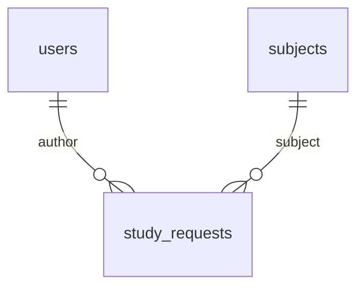

# Сервис поиска партнеров для учебы

Студенты выбирают предмет, дату и формат совместной подготовки и просматривают
запросы участников. Индивидуальная тема: «Сервис поиска партнеров для учебы».

## Текущее состояние — ПР7

Все веб-страницы получают данные из `data/study_partner.sqlite` стандартным
модулем Python `sqlite3`. Django ORM для данных предметной области не используется.
19 именованных SQL-запросов из `sql/queries.sql` исполняются самим сайтом.
Сохранены шаблоны, CSS, SVG, быстрые фильтры JavaScript и обработчики 404 ПР6.
Основные новые возможности: серверный поиск по дате/предмету/формату/автору/статусу
и статистика с COUNT, SUM, MIN/MAX, GROUP BY и настраиваемым HAVING.

Это учебный каталог запросов: авторизация, переписка, создание пары и веб-редактирование
пока не реализованы. Активность определяется флагом is_closed, а не текущей датой.
Даты исходных примеров исторические. Участник без активного запроса на выбранную
дату не обязательно свободен — сайт явно поясняет это.
Яндекс Практикум отложен по поручению пользователя.

## Подготовка и запуск (PowerShell из корня проекта)

```powershell
python -m venv venv
.\venv\Scripts\python.exe -m pip install -r requirements.txt
.\venv\Scripts\python.exe -m db.database
.\venv\Scripts\python.exe -m db.import_json
.\venv\Scripts\python.exe manage.py migrate
.\venv\Scripts\python.exe manage.py runserver 127.0.0.1:8007
```

При следующих запусках достаточно последней команды. Поставка уже содержит БД.
`db.database` создает схему с IF NOT EXISTS, не удаляя данные.
Импорт читает исходные JSON, использует executemany и одну транзакцию для всех трех
коллекций. Сначала users и subjects, затем study_requests. ID сохраняются; дата
ДД.ММ.ГГГГ преобразуется в YYYY-MM-DD, bool — в INTEGER 0/1, пустая группа — NULL.
При ошибке вставок транзакция откатывается. Повторный импорт добавляет отсутствующие
ID, но не обновляет существующие (`ON CONFLICT(id) DO NOTHING`). Он не синхронизирует
измененные или удаленные записи JSON с БД. Для проверки чистого импорта:

```powershell
.\venv\Scripts\python.exe -m db.import_json --database data/demo.sqlite
```

Файл `demo.sqlite` — отдельная учебная копия, ее не следует добавлять в Git.
Все пути вычисляются от файлов модулей, независимо от текущей рабочей папки.
Обычное соединение открывает БД с `mode=rw`: опечатка в пути вызовет ошибку,
а не создаст незаметно пустую базу. Создание разрешено только инициализатору.
`PRAGMA foreign_keys=ON` и `row_factory=sqlite3.Row` устанавливаются на каждом соединении;
соединения закрываются через contextlib.closing. `with connection` управляет транзакцией,
но само по себе не закрывает соединение.

Служебная Django БД `db.sqlite3` существует отдельно и не содержит таблиц проекта.
`manage.py migrate` работает только со служебными приложениями Django.
При переносе папки venv необходимо пересоздать. DEBUG управляется DJANGO_DEBUG,
ALLOWED_HOSTS по умолчанию localhost и 127.0.0.1.

## Схема базы данных

| Таблица | Поля и типы | Ограничения |
|---|---|---|
| users | id INTEGER; name TEXT; group_name TEXT | id PK; name NOT NULL, не пустое; group_name допускает NULL |
| subjects | id INTEGER; name TEXT | id PK; name NOT NULL, не пустое |
| study_requests | id INTEGER; user_id INTEGER; subject_id INTEGER; format TEXT; study_date TEXT; is_closed INTEGER | id PK; остальные NOT NULL; два FK; format онлайн/офлайн; дата ISO; статус 0/1, DEFAULT 0 |

`study_requests.user_id → users.id`, `study_requests.subject_id → subjects.id`:
отношения многие-к-одному, удаление родителей с запросами запрещено (RESTRICT).
CHECK для даты проверяет длину и календарную нормализацию через date(..., '+0 days').
Индексы: (subject_id,is_closed), (user_id,study_date,is_closed), (study_date).
Схема — `sql/schema.sql`. Исходный импорт: 4 пользователя, 3 предмета, 5 запросов;
4 активных, 1 закрытый. Только group_name допускает NULL (кроме особенностей INTEGER PK:
SQLite генерирует ID при вставке NULL). Это не Django-модели.



## Страницы

| Адрес | Назначение | Имя URL |
|---|---|---|
| `/` | Предметы, показатели, три последних запроса | homepage:index |
| `/subjects/` | Предметы с числом активных запросов | subjects:list |
| `/subjects/1/` | Предмет и только его активные запросы | subjects:detail |
| `/requests/` | Все запросы; `?status=active` / `closed` — SQL-фильтрация | requests:list |
| `/requests/5/` | Карточка с автором и предметом из JOIN | requests:detail |
| `/requests/search/` | Поиск через GET, работающий без JavaScript | requests:search |
| `/requests/statistics/` | Сводные таблицы, `?min_count=2` задает HAVING | requests:statistics |

Полный адрес примера: http://127.0.0.1:8007/requests/search/?date=2026-09-18&subject=1&format=онлайн&status=active
Результат — Дмитрий, запрос №3. Без активных запросов на эту дату: Алексей, Мария, Артём.
`date`, `subject`, `format`, `user`, `status` необязательны; по умолчанию только активные.
Пустое условие передается как None/NULL и отключает соответствующий фильтр.
Ошибочные даты, идентификаторы, перечисления и порог дают HTTP 400 с пояснением.
Несуществующий корректный ID в поиске дает пустой список, а на странице объекта — 404.

## Каталог SQL: все запросы используются веб-приложением

| Имя в queries.sql | Вид | Где используется |
|---|---|---|
| list_subjects | SELECT списка | главная, список предметов формы поиска |
| list_users | SELECT списка | список авторов формы поиска |
| subject_by_id | WHERE | карточка предмета |
| active_requests | WHERE, JOIN | каталог активных запросов |
| closed_requests | WHERE, JOIN | каталог закрытых запросов |
| all_requests | JOIN | общий каталог запросов |
| request_by_id | JOIN, WHERE | карточка запроса |
| requests_for_subject | JOIN, WHERE | активные запросы выбранного предмета |
| search_requests | JOIN, WHERE по пяти параметрам | серверный поиск |
| request_totals | COUNT, SUM, COALESCE | главная, статистика |
| catalog_totals | COUNT | главная, статистика |
| subjects_statistics | LEFT JOIN, COUNT, GROUP BY | предметы, статистика |
| users_statistics | LEFT JOIN, COUNT, SUM, GROUP BY | статистика участников |
| popular_subjects | WHERE, GROUP BY, HAVING | популярные предметы с заданным порогом |
| format_statistics | COUNT, SUM, GROUP BY | статистика форматов |
| date_range | MIN, MAX | период запросов в статистике |
| users_without_requests_for_date | NOT EXISTS, WHERE | участники без активного запроса на выбранную дату |
| recent_requests | JOIN, ORDER BY, LIMIT | недавние запросы главной |
| distinct_formats | SELECT DISTINCT | форматы в форме поиска |

Требование «минимум 10 и по два каждого вида» выполнено: простых списков 2,
WHERE ≥2, JOIN ≥2, агрегатных ≥2, GROUP BY 4. Категории могут пересекаться.
SQL-файл читается при выполнении: правку запроса можно проверить обновлением страницы.
Имена запросов фиксированы в коде, пользователь не выбирает SQL или имена таблиц.
Значения передаются отдельно: `query("subject_by_id", (subject_id,))`.
`?1`, `?2` — нумерованные параметры SQLite; db.database преобразует последовательность
в словарь с ключами "1", "2" для DB-API. Строковая подстановка пользовательских значений
и f-строки для них не используются. В импортере f-строка COUNT применена только к
фиксированным именам трех таблиц, не к пользовательским данным.

## Путь данных и структура

`GET → requests.views.search → валидация → db.repository.search_requests →
db.database.query → sql/queries.sql → sqlite3.Row → объект StudyRequest →
context["study_requests"] → requests/search.html → HTML`.
Статистика передает sqlite3.Row напрямую: `{{ row.active_count }}` обращается по имени.
Адаптер repository восстанавливает вложенные User/Subject для прежних карточек ПР6.
Агрегирование и фильтрация выполняются SQL, не Python-циклами.

```text
db/database.py       соединение, создание схемы, исполнение именованных SQL
db/import_json.py    транзакционный импорт JSON
db/repository.py     строки SQLite → объекты ПР3
sql/schema.sql      CREATE TABLE/INDEX
sql/queries.sql     19 запросов, выполняемых сайтом
data/*.json         исходные коллекции и прежняя консольная реализация
data/study_partner.sqlite    рабочая БД веб-приложения
homepage/ subjects/ requests/    views, urls, templates
templates/          base, navigation, footer, 404
homepage/static/    локальные CSS, JS, SVG
src/ main.py        прежняя объектная модель и консольное JSON-приложение
tests/              98 тестов, в том числе test_sqlite.py
```

Консольный запуск: `.\venv\Scripts\python.exe main.py`. Он по-прежнему пишет JSON;
изменения существующих JSON-записей автоматически на сайт не переносятся.

## Проверки

```powershell
.\venv\Scripts\python.exe manage.py check
.\venv\Scripts\python.exe -m pytest -v
.\venv\Scripts\python.exe -m flake8 . --extend-exclude=venv
```

ПР7: 98 тестов, check и flake8 проходят. Каждый тест использует временную SQLite;
рабочая база и JSON не меняются. Проверяются PK/FK/CHECK, NULL, откат импорта,
повторный запуск, параметризация, JOIN/GROUP BY/HAVING, веб-поиск, пустые состояния,
ошибочный ввод и сохраненные сценарии ПР1–ПР6. Отдельный тест проходит страницы
и проверяет выполнение всех 19 именованных запросов. SQL-ошибка не выдается за
пустой результат: диагностируется sqlite3.OperationalError.

Для SQLite CLI, если sqlite3.exe в PATH:

```powershell
sqlite3 data/study_partner.sqlite
```

```sql
.headers on
.mode table
.schema
PRAGMA foreign_keys=ON;
PRAGMA database_list;
SELECT COUNT(*) FROM users;
SELECT COUNT(*) FROM subjects;
SELECT COUNT(*) FROM study_requests;
.parameter init
.parameter set ?1 2
SELECT s.name, COUNT(r.id) AS active_count
FROM subjects s JOIN study_requests r ON r.subject_id=s.id
WHERE r.is_closed=0 GROUP BY s.id,s.name HAVING COUNT(r.id)>=?1;
PRAGMA integrity_check;
PRAGMA foreign_key_check;
.quit
```

Ожидается 4/3/5, Математика=2, integrity_check=ok, foreign_key_check без строк.
В рабочем окружении официальная CLI сохранена рядом с проектом:
`..\work\sqlite-tools\sqlite3.exe`; `..\work\check_pr7_cli.py` исполняет все 19 запросов
и сохраняет журнал в `..\отчет\ПР7`. Загрузка с sqlite.org проверена по SHA3-256.
SQLite Viewer (`qwtel.sqlite-viewer`) установлен в VS Code: открыть
`data/study_partner.sqlite` и выбрать таблицу. Это просмотрщик; SQL исполняется CLI.

## Сохраненные версии для защиты

| Работа | Git-коммит | Запуск в учебной папке |
|---|---|---|
| ПР1 | 510904e | история Git |
| ПР2 | b54f1ff | история Git |
| ПР3 | 8e2ddd8 | история Git |
| ПР5 | 98621f5 | Запустить_ПР5.cmd, порт 8005, версии/PR5 |
| ПР6 | 50c4e42 | Запустить_ПР6.cmd, порт 8006, версии/PR6 |
| ПР7 | коммит с префиксом PR7 | Запустить_ПР7.cmd, порт 8007, основной проект |

ПР5 и ПР6 используют отдельные сохраненные копии; основной проект развивается дальше.
Их уже подготовленные отчеты не изменяются. Для неизвестного URL общий handler404
работает при DEBUG=False; отсутствующий объект возвращает 404 непосредственно из view.
Для локального показа статики при DEBUG=False: runserver --insecure. Этот флаг
не предназначен для развертывания в интернете.
